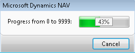
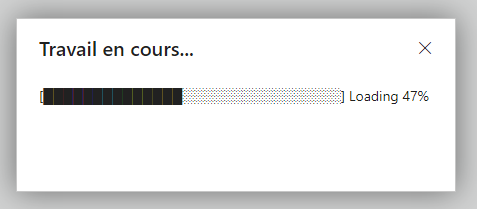

# Progress Bar Indicator
In a world where users often have to wait for processes to complete, a reliable progress indicator can make all the difference in user experience. We understand that, in Business Central 14 and earlier versions, which primarily utilized the Windows client, displaying progress indicators in percentages was a standard practice. However, as technology evolves, so do the challenges.


## The Challenge: 🌐🕒
In the modern landscape of Business Central, particularly in the Web Client, the native support for progress indicators in percentages is missing, leaving developers searching for solutions.

> The percentage in the progress bar was a standard feature:  
 

## The Solution: 🚀📊
**Progress Bar Indicator** We recognized the need for a straightforward yet effective tool to simulate progress bar indicators in percentages when the native support isn't available.

> The Progress Bar Indicator:  
 

## How It Works: 🛠️👨‍💻
Our tool simplifies the process of creating a progress bar indicator within your AL code. With a basic procedure [`GenerateProgressBar`](./src/ProgressBarIndicator.Codeunit.al) that converts values to a string format, we provide a practical way to keep your users informed about ongoing processes.

# Usage 
```
actions
{
    area(Processing)
    {
        action(ActionName)
        {
            ApplicationArea = All;
            Caption = 'someAction';
            Image = Capacity;
            trigger OnAction()
            var
                ProgressBarIndicator: Codeunit ProgressBarIndicator;
                RecordCustomer: Record Customer;
                RecordCounter: Integer;
                RecordTotalCounter: Integer;
                Window: dialog;
                WindowMssg: Label '############################################1';
            begin
                Clear(RecordCounter); // Reset counter
                RecordCustomer.reset();

                Window.Open(WindowMssg);
                RecordTotalCounter := RecordCustomer.Count;
                if RecordCustomer.FindSet() then begin
                    repeat begin
                        RecordCounter += 1;

                        // Add your custom processing logic here....

                        Window.Update(1, ProgressBarIndicator.GenerateProgressBar(RecordCounter, RecordTotalCounter)); // Update the progress bar.

                        Sleep(500); // Slow down the process with 0.5 seconds just for demo purposes.
                    end until RecordCustomer.Next() = 0;
                end;
                Window.Close();
            end;
        }
    }
}
```

# To-Do
Feel free to contribute to this project! Here are some to-do items and improvements we'd like to see:
- [ ] Multi-progress bar mode allows tracking progress for multiple tasks simultaneously.
- [ ] More  Styles could include different shapes:  
        - [######.............]  
        - [======-------------]
